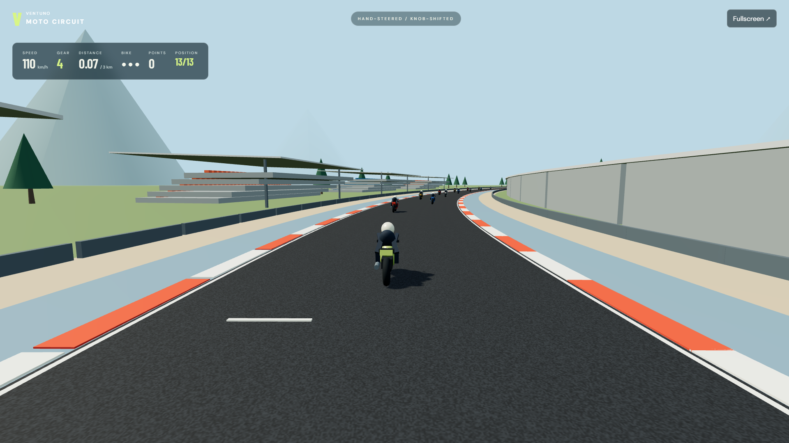

# VENTUNO Moto Circuit (App Lab project: VENTUNO Highway)



From the repository root, run `python tools/package_apps.py` and import
`dist/ventuno-highway.zip`. Alternatively, run `python ventuno-highway/scripts/package.py`
to create `ventuno-highway-applab.zip`. Both package source without model weights.

A playable 3 km motorcycle racing game for Arduino App Lab. The VENTUNO Q USB camera and quantized MediaPipe palm / hand-landmark models provide steering. Modulino Knob controls gears 1–6 through an MCU sketch. The laptop browser renders a fictional 3D circuit using locally bundled Three.js 0.186.1: a chase camera, textured asphalt, kerbs, grandstands, pit buildings, dynamic shadows, and 12 rival bikes. A 3–2–1 countdown launches the field; collisions animate a bike slide, rider tumble, sparks, and dust. No LLM, model swaps, hosted inference, or external actuator is required. This is an original arcade racer, not an official MotoGP title or real circuit simulation.

## Hardware

Power the VENTUNO Q correctly, attach a USB camera to its USB host port, and connect Modulino Knob to the MCU Qwiic bus. Use the laptop display or laptop HDMI monitor. Only one camera-owning app should run at once.

## Install and launch

Import `ventuno-highway-applab.zip` into App Lab. The expected board directory is `/home/arduino/ArduinoApps/ventuno-highway`; if the importer chooses a different name, update the bind paths in `bricks/highway_perception/brick_compose.yaml`. On the board run `sh scripts/setup.sh` from that directory once. This reuses the existing Reality Engine image/runtime when present, or builds the pinned Arduino runner and stages matching DSP files. Then run VENTUNO Highway from App Lab, which compiles/uploads the MCU sketch. The separate project does not replace Smart Mirror or Reality Engine source; launching it changes the active MCU sketch.

For a USB connection on Windows:

```powershell
adb forward tcp:7000 tcp:7000
Start-Process http://localhost:7000/
```

## Play

- Press Start with your hands in a comfortable handlebar pose. There are no calibration buttons or control settings on the game screen. The relaxed wrist reference is captured automatically from actual tracked samples, waiting if no hand is initially visible; gears are automatic. Your first deliberate right-wrist twist after Start establishes the acceleration direction. Twist the opposite way to brake; return to neutral to retain speed. The visible meter turns red and reads Wrist Brake for reverse input. There is no minimum throttle; wrist control can be checked directly in the visible Wrist Throttle meter. Hand tracking still pauses the race if the hands disappear.
- Wrist orientation is estimated from NPU hand landmarks with CPU geometry. It remains approximate; no physical throttle sensor or new trained wrist model is claimed. Manual calibration endpoints remain available internally but are not required to start or shown in the UI.
- Hold both hands in front of the camera like handlebars, shoulder-width apart, and press Start. The current angle is calibrated as straight ahead.
- Tilt the imaginary handlebars clockwise (your right hand lower) to steer right; tilt the other way to steer left. The preview is mirrored. One-hand horizontal steering is also supported, with a separate neutral position.
- Optional internal/manual mode supports Knob gear changes, clamped to 1–6. The default wrist mode uses automatic gears and integrates acceleration: partial twist can build speed above 50 km/h, neutral holds speed, and reverse twist brakes. The older cruise and manual controls are not exposed as settings on the simplified screen.
- Press the Knob to pause/resume, or start while on the welcome screen. Restart from a relaxed handlebar pose if your neutral pose changes.
- The grid stays still through 3–2–1, then you and the rivals accelerate. Twist to accelerate and overtake; the HUD shows your position among 13 riders.
- Avoid rival bikes. A collision causes a two-second crash sequence and costs one bike-health point; the first two recover with brief collision immunity. A third collision shows the crash before ending the race. Reaching 3 km finishes the lap. Going onto the shoulder slows the bike. Losing hands or the board connection freezes driving and the race countdown. Hidden tabs temporarily suspend simulation; returning resumes automatically. Clicking outside the window no longer latches a pause. Explicit P/Knob/Pause-button pauses remain until resumed.
- Keyboard test drive: left/right arrows steer, up/down select gear, Space brakes, P pauses, Enter starts. When the Knob is missing, arrow-key gear control also works with hand steering.
- Sound is optional browser-generated engine audio, enabled by the Sound button. No speaker on the board is needed.

## Runtime truth

The UI shows the actual tracking provider. QNN acceleration is requested for palm and landmark models; initialization validates delegate attachment, delegated partitions, and a warm invocation. If unavailable, `auto` reports its CPU fallback rather than claiming NPU execution. The canned gesture classifier and preprocessing use CPU. The game uses positions/landmarks, not an LLM. New-game hardware performance must be measured separately; the previous Reality Engine benchmark is not a benchmark for this game.

Camera frames remain transient and the main app does not persist them. Inherited worker logs contain aggregate timing/gesture metrics. The HTTP UI is for a trusted local board/laptop connection, not public internet hosting. Google font downloads are optional cosmetic assets; the system font fallback works without them.

The 3D view requires WebGL 2 in the laptop browser. A lightweight 2D road renderer remains available as an automatic fallback when WebGL initialization fails; the footer explicitly shows the active renderer. Three.js modules and their MIT license are bundled under `assets/vendor`, so no CDN or map key is required. Rendering performance depends on the laptop GPU and display resolution; no steady FPS guarantee is made.

## Checks

`python3 -m unittest discover -s tests -v` validates mirrored steering, confidence filtering, calibration, encoder wraparound/reset, and gear bounds. `node tests/physics.cjs` validates tracking-loss pause, speed limits, collisions, and game lifecycle. `node --check assets/app.js` checks browser syntax.

## Reused components

The perception pipeline is adapted from the existing AI Reality Engine. Arduino's pinned gesture runner supplies its matching quantized TFLite models/runtime. `perception/arduino_inference.py` retains Arduino MPL-2.0 notices; OpenCV Zoo license is included for the optional legacy adapter. Runtime binaries and model weights are excluded from the import archive.

Application source follows this repository's MPL-2.0 license. Three.js retains
its bundled MIT license, and the legacy adapters retain their OpenCV notices.
Screenshots in `docs/` use controlled software inputs, without live camera images.
